<div align="center">

# Hi, I'm Moanes 👋

**Software engineer from Tunisia** · full-stack web, mobile and DevOps

[](https://linkedin.com/in/moanesbbr)
[](https://x.com/Moanesbbr)
[](mailto:moanesbbr@gmail.com)
[](https://tunispare.com)


</div>

I build products end to end, from the database to the server they run on.
Full-stack developer at **Traveltodo**, formerly mobile developer at **Solidwall Consulting** (1 year),
with an engineering degree in software engineering.

## 🚀 Now building: [Tunispare](https://tunispare.com)

A platform for phone repair shops in Tunisia: find the spare part that fits, buy it from local
suppliers with delivery, and run the shop (stock, point of sale, repair tickets, invoices).

- **AI search on our own model:** a self-hosted Qwen model answers workshops in French,
  Tunisian darija and English, typed or spoken, from Tunispare's own catalogue
- **Compatibility data:** scrapers collect which parts fit which phones, then match them to the catalogue
- **Production I run myself:** k3s on a VPS set up with Ansible, CI/CD with GitHub Actions,
  monitoring with Prometheus, Grafana and Loki, nightly encrypted backups
- **Security tested:** SAST, dependency and image scanning, DAST, OWASP ASVS Level 2 checklist, load tests with k6

`NestJS` · `Next.js` · `TypeScript` · `MySQL` · `Python` · `Docker` · `Kubernetes`

## 🛠 Tech stack

**Languages**


**Backend**


**Frontend & mobile**


**DevOps & AI**


## 📌 Side projects

<div align="center">

<a href="https://github.com/Moanesbbr/tekup-grades-calculator"></a>
<a href="https://github.com/Moanesbbr/WebMaster-Pro"></a>
<a href="https://github.com/Moanesbbr/HotspotKeeper"></a>
<a href="https://github.com/Moanesbbr/ExpenseFlow"></a>

</div>

## 📊 GitHub stats

<div align="center">




</div>

## ⏱ This week (WakaTime)

<div align="center">

<!--START_SECTION:waka-->

```txt
Markdown         4 hrs 14 mins         ██████▓░░░░░░░░░░░░░░░░░░   26.09 %
TeX              3 hrs 35 mins         █████▓░░░░░░░░░░░░░░░░░░░   22.01 %
Other            2 hrs 22 mins         ███▓░░░░░░░░░░░░░░░░░░░░░   14.55 %
JavaScript       2 hrs 7 mins          ███▒░░░░░░░░░░░░░░░░░░░░░   13.01 %
Python           59 mins               █▓░░░░░░░░░░░░░░░░░░░░░░░   06.09 %
```

<!--END_SECTION:waka-->

</div>

---

<div align="center"><i>Make it work, make it right, make it fast.</i></div>
